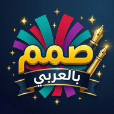
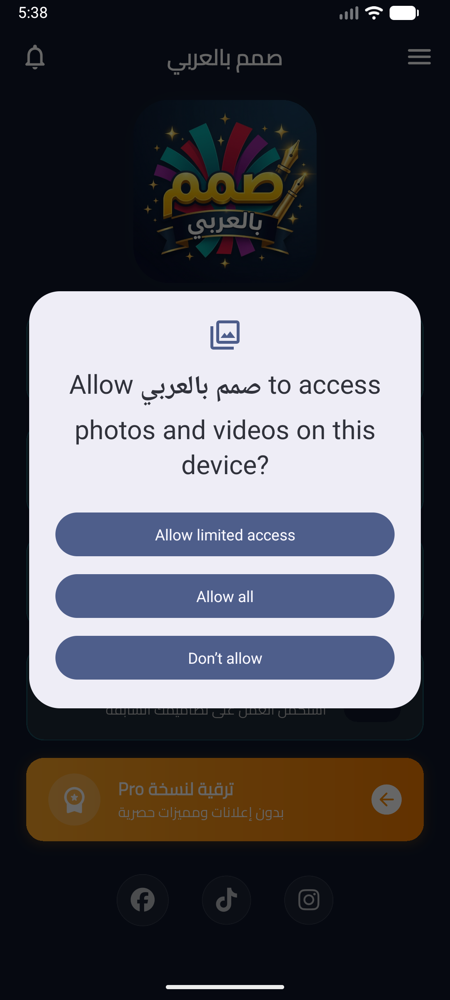
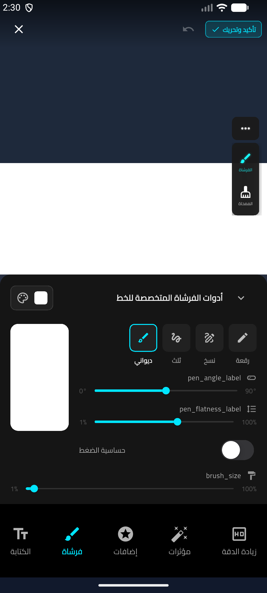
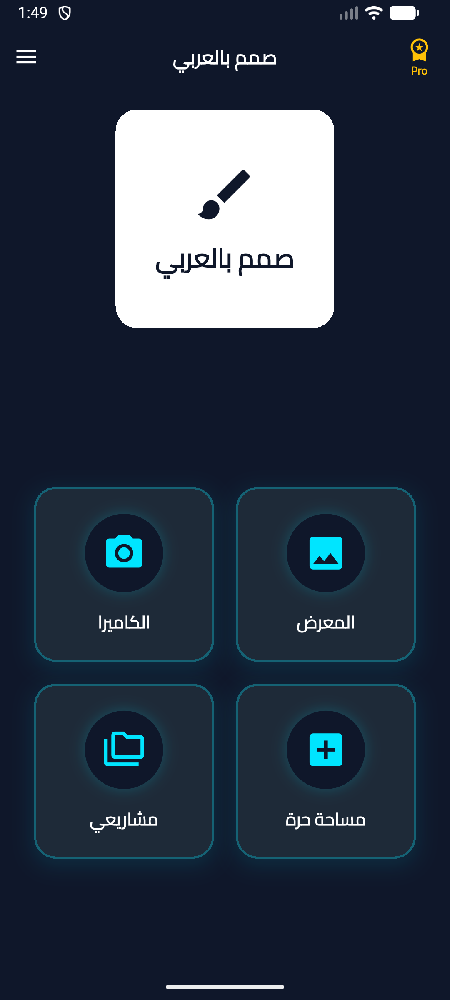

# صمم بالعربي | Arabic Designer
### مصمم صور احترافي والكتابة بالخطوط العربية | Professional Photo Editor & Typography

 

---

## 📱 حول التطبيق | About The App

### بالعربية:
تطبيق **"صمم بالعربي"** هو أداتك الشاملة والمتكاملة لتصميم وتعديل الصور والكتابة عليها باحترافية وسهولة تامة. يمنحك التطبيق تجربة إبداعية فريدة من خلال مكتبة غنية بأجمل الخطوط العربية والإنجليزية، وأدوات تعديل متقدمة تتيح لك تفريغ الخلفيات بدقة، إزالة وإصلاح العيوب، تطبيق فلاتر سينمائية، وإضافة لمسات فنية رائعة على منشوراتك وبوستات التواصل الاجتماعي بكل سهولة وبدون تعقيد.

### In English:
**Arabic Designer** is your all-in-one professional photo editing and typography app, with full support for both Arabic and English languages. Designed to empower creators worldwide, it offers an extensive collection of elegant Arabic and English fonts alongside powerful editing tools. Easily remove backgrounds with precision, retouch photos using the clone tool, apply cinematic filters, and craft stunning social media posts effortlessly without complexity.

---

## 📸 لقطات من التطبيق | App Screenshots

  
  &nbsp;
  
  &nbsp;
  
  &nbsp;
  

---

## ✨ المميزات الرئيسية | Key Features

- 🔤 **خطوط عربية وإنجليزية احترافية (Bilingual Typography):** تشكيلة واسعة من أجمل الخطوط العربية والإنجليزية مع تحكم كامل في الظل، التحديد، اللون والتدرج.
- ✂️ **إزالة الخلفية الذكية (Background Eraser):** أداة متطورة لعزل وتفريغ الخلفيات بدقة فائقة مع خيارات الحذف التلقائي، الفرشاة اليدوية، والاسترجاع.
- 🎯 **أداة الاستنساخ والختم (Clone & Stamp):** إزالة العيوب والعناصر غير المرغوب بها من الصور بسلاسة واحترافية.
- 🎨 **فلاتر ومؤثرات سينمائية (Filters & Effects):** فلاتر لونية احترافية لتحسين جودة وإضاءة الصور بلمسة واحدة.
- 🖼️ **ملصقات وزخارف إسلامية (Stickers & Calligraphy):** مكتبة ثرية من المخطوطات والزخارف الإسلامية والعربية الجاهزة لمختلف المناسبات.
- 📐 **مقاسات السوشيال ميديا (Social Media Ready):** مساحة تصميم حرة وقوالب مقاسات جاهزة مخصصة لإنستغرام، تيك توك، يوتيوب وغيرها.
- 🚀 **جودة فائقة وبدون علامة مائية (High Resolution - Zero Watermark):** حفظ وتصدير الصور بدقة عالية مجاناً وبدون أي علامة مائية.

---

## 📥 التحميل والتثبيت | Download
التطبيق متاح رسمياً ومجاناً على متجر Google Play:

👉 **[اضغط هنا لتحميل تطبيق "صمم بالعربي" من متجر Google Play](https://play.google.com/store/apps/details?id=com.orvex.arabic_designer)**

---

**Developed by ORFLYS**  
[Website](https://orflys.com) • [Support](https://orflys.com/support)

© 2026 ORFLYS. جميع الحقوق محفوظة | All rights reserved.

